这次用两天时间，把一套以 Ryzen 7 7800X3D 为核心的主机组装起来，并完成了 Windows 11 安装和第一次 CPU 压力测试。过程里需要确认的事情比预想中多：一根 DDR5 能不能先用、风扇的正反叶怎么区分、灯线和转速线接哪里、旧启动 U 盘能不能继续利用，以及电脑点亮后怎样判断安装是否可靠。

把这些问题放回完整流程中，比单独记住某个接口或某个 BIOS 选项更有用。这篇文章按“准备配件 → 硬件安装 → 接线与风道 → 首次开机 → 系统安装 → 初步验收”整理，也保留这次已经有记录的参数与结果。

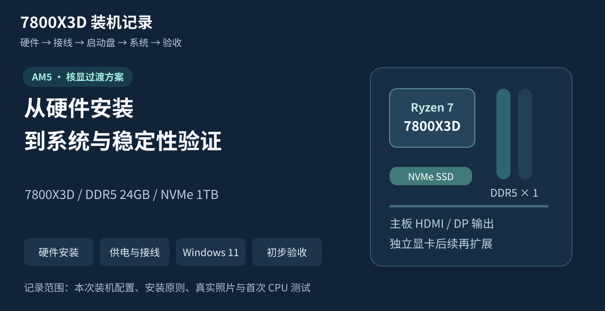

图中的结构示意均为本文绘制；现场照片和软件画面来自本次装机记录。没有完整留存的 BIOS 版本、硅脂具体型号、Windows 小版本和最终磁盘分区方案不作补写。相关厂商资料核对日期为 2026-11-02。

<!-- more -->

## 本次配置，以及目前完成到了哪一步

### 配置与采购记录

这台电脑先利用 CPU 的集成显卡完成装机和环境准备，独立显卡留到以后再加。内存沿用已有的一根 24GB DDR5，避免为了立即配齐套条打乱预算。

| 配件 | 本次配置 | 记录金额 |
| --- | --- | ---: |
| CPU | AMD Ryzen 7 7800X3D 散片 | 与主板合计 |
| 主板 | 华硕 TUF GAMING B650EM-PLUS WIFI | ¥2,499.00，含 CPU |
| 内存 | 七彩虹双子座 DDR5-6000 CL30，24GB × 1 | 沿用旧件，未计入新增支出 |
| SSD | 致态 TiPlus7100s 1TB | ¥953.42 |
| CPU 散热器 | 利民 Phantom Spirit 120 SE ARGB，黑色 | ¥163.00 |
| 电源 | 微星 PAG G750N WHITE，750W 金牌 | ¥218.95 |
| 机箱 | 瓦尔基里 VK03M 黑色屏显版 | ¥263.65 |
| 机箱风扇 | 棱镜 6Pro：黑色反叶 × 5、正叶 × 1，含控制器 | ¥115.30 |
| 独立显卡 | 暂未安装，使用 7800X3D 核显 | ¥0 |
| **新增配件合计** | **不含旧内存、系统授权、显示器与外设** | **¥4,213.32** |

金额沿用本次后一次整理的采购清单，并非实时行情。机箱金额在早期记录中有 ¥0.30 的出入，精确记账仍应以订单为准。若继续以 ¥8,000 为总预算计算，尚余 ¥3,786.68，但这不代表未来显卡一定能在该金额内买到。

### 已完成的事情与后续项目

目前可以确认，主机已经完成组装、进入 BIOS、安装 Windows 11，并运行了 OCCT CPU 测试。后续记录中的内存配置为 EXPO I、DDR5-6000 CL30；专门验证该配置的内存压力测试仍是下一步。

| 项目 | 本次记录 |
| --- | --- |
| 主机点亮、进入 BIOS | 已完成 |
| Windows 11 与桌面运行 | 已完成，有测试照片 |
| CPU 初步压力测试 | OCCT CPU，10 分钟，未检测到错误 |
| CPU 温度记录 | `CPU (Tctl/Tdie)` 最高 79.63°C |
| Windows 内存诊断 | 当时讨论记录为未报错，未留存独立结果报告 |
| EXPO 下的专门内存压力测试 | 尚未记录完成结果 |
| 独显安装、独显驱动与游戏验收 | 后续项目 |
| WSL2、原生 Ubuntu 双系统 | 讨论过的扩展方向，不列为已安装 |

## 开工前：确认兼容性，再准备工具

### 一台主机需要哪些部件互相匹配

CPU、主板和内存要先形成匹配的平台。这次的 7800X3D 使用 AM5 插槽，配套主板使用 DDR5，不能换成 DDR4，即使两者都是台式机长条内存也不能硬插。主板还需要有支持该 CPU 和内存的 BIOS。

机械尺寸同样影响能否装进去：M-ATX 主板的孔位要与机箱铜柱对应；塔式散热器要看机箱限高；未来增加显卡还要检查长度、厚度、供电接口和走线空间。PS120 SE 官方标称高度为 154mm，但前风扇为避让较高的内存而上移后，整套散热器的实际高度会增加。[利民产品规格](https://www.thermalright.com/product/phantom-spirit-120-se-argb/)

电源除了额定功率，还要看 CPU 供电线、显卡供电线、接口数量、输入电压和具体显卡的电源要求。**750W 不代表电脑一直消耗 750W，金牌认证也不能代替对接口和产品规格的核对。** 本次 PAG G750N WHITE 的交流输入范围应直接看实物铭牌；不能因为别的电源支持宽幅输入，就推定这一款也一样。

### 工具与操作环境

准备一把合适的十字螺丝刀、装螺丝的小盒子、照明，以及主板、散热器、机箱和风扇控制器的说明书。若需要重新安装散热器，再准备适用的清洁用品与硅脂。玻璃侧板拆下后放在柔软、稳定的位置，避免边角碰到瓷砖等硬物。

在整洁、干燥的桌面上操作，减少地毯、毛衣等带来的静电。拿主板、内存和 SSD 时尽量抓边缘，避免触摸触点和裸露元件；有合适的防静电措施就按其说明使用。机箱外安装时可以用主板包装纸盒承托，防静电袋外表面不适合作为通电测试台。

**凡是安装、拔插内部硬件和线缆，都先关机，将电源开关拨到 `O`，拔掉交流电源线，再等待待机灯熄灭。** Windows 已关机不代表主板没有待机供电；机箱灯光还亮着时，更不能直接调整 ARGB、风扇或屏幕接线。[华硕安装指南](https://dlcdnets.asus.com/pub/ASUS/mb/SocketAM5/TUF_GAMING_B650EM-PLUS_WIFI/C25967_TUF_GAMING_B650EM-PLUS_WIFI_QSG_WEB.pdf?model=TUF+GAMING+B650EM-PLUS+WIFI)

### 安装顺序为什么这样安排

在机箱外先装 CPU、内存和 M.2 SSD，操作空间更大，也方便看清缺口和锁扣。塔式散热器安装前，先判断它会不会挡住 CPU 供电插头、主板固定螺丝或 M.2 散热片；需要时先把线穿好，再固定散热器。

一个适合这套硬件的顺序是：

1. 核对配件与机箱铜柱，识别主板接口。
2. 安装 CPU、内存、SSD，以及散热器所需扣具。
3. 安装散热器；若空间冲突，就在主板入箱后完成风扇或塔体安装。
4. 固定电源和主板，连接主供电、CPU 供电及前面板线。
5. 安装机箱风扇与控制器，整理线缆。
6. 检查后通电，确认 BIOS 识别，再安装系统与驱动。
7. 在默认配置稳定的基础上启用 EXPO，分项目验收。

这不是必须一字不差执行的顺序。关键是提前识别会被遮挡的位置，减少反复拆装。

## 机箱外安装：CPU、内存、SSD 与散热器

### 先认识这块主板

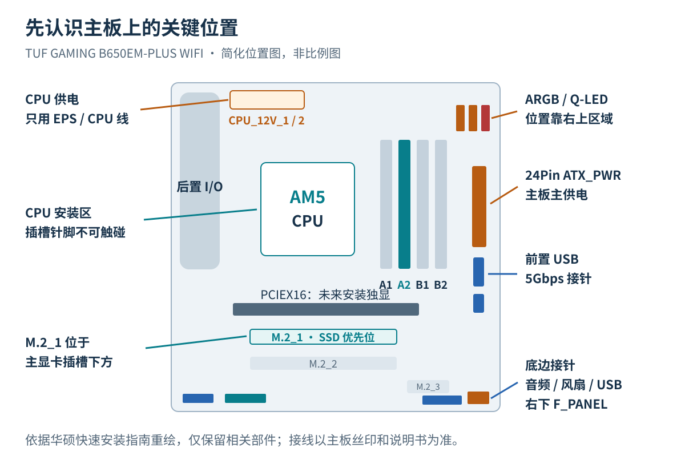

图中按本板快速安装指南保留主要位置，省略了不相关元件。这里有一个容易凭经验看错的地方：**本板的 `M.2_1` 在主显卡插槽下方**，不能把“离 CPU 最近、在显卡插槽上面”当作所有主板通用的定位方法。查找时认准 `M.2_1`、`CPU_FAN`、`ATX_PWR` 等丝印。

### CPU：三角对齐，轻放到位

AM5 是 LGA 插槽，精细针脚在主板插槽内。安装时拿住 CPU 边缘，打开固定机构，对齐 CPU 与插槽的三角标记及定位缺口，垂直轻放。确认平整落座，再按说明闭合压框、压下锁杆。

锁杆到最后一段出现一定阻力，与 CPU 放不进插槽时强行按压，是两种不同情况。如果 CPU 不能自然平放，应停止并重新检查方向。不要在插槽里滑动 CPU，也不要触摸、擦拭或自行拨动针脚。

插槽保护盖按说明书规定处理，通常在正确安装并锁定后脱落；保留保护盖，未来主板运输或售后可能用到。普通塔式散热器安装不需要拆 CPU 插槽的金属固定机构。

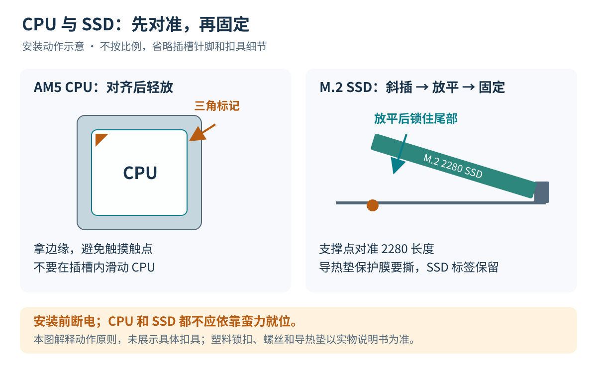

### 内存：当前一根先插 A2

本次只装一根 24GB 内存。对于这块主板，单条优先使用 `A2`，从 CPU 向外数通常是第二个插槽；以后安装两条匹配内存，优先使用 `A2 + B2`。这个顺序已在本板快速安装指南中确认。

打开活动卡扣，对齐内存缺口，保持两端水平并均匀下压。不要强行掰开固定端卡扣。安装后观察内存是否平整、两端是否完全到位；只听到某一侧“咔哒”一声，不能代替检查另一侧。

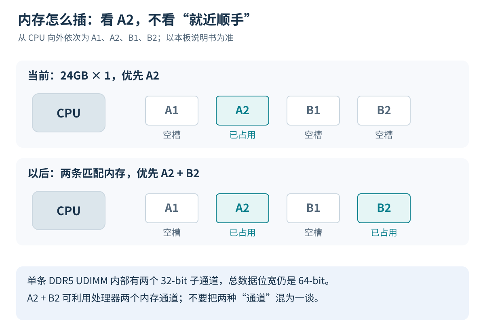

这里顺便厘清几个容易混淆的参数：

| 参数 | 表示什么 | 对本次配置的意义 |
| --- | --- | --- |
| 24GB | 容量，能容纳多少工作数据 | 决定多任务、容器等场景的容量余量 |
| DDR5-6000 | 6000MT/s 的标称数据传输率 | 不应严格写成 6000MHz 物理时钟 |
| CL30 | CAS 延迟对应的时钟周期数 | 不能脱离传输率单独比较快慢 |
| 一条或两条 | 内存通道的占用方式 | 影响可用带宽，不只是容量相加 |

常规非 ECC DDR5 UDIMM 内部有两个 32 位子通道，但整条的数据位宽仍为 64 位；这不等于已经利用了 CPU 两个内存通道的完整带宽。DDR5-6000 单条的理论数据带宽约为 `6000 × 8 = 48000MB/s`，两通道合计约 96GB/s；实际应用性能不会简单翻倍。[Kingston DDR5 技术说明](https://media.kingston.com/kingston/articles/MKF_954-DDR5-Collateral_us.pdf)

DDR5 也不会让同一款软件天然少占内存。代际、带宽、时序和容量解决的是不同问题。本次沿用单条是过渡方案；将来补条应优先考虑匹配套装与兼容性，即使型号一样，不同批次混用也不能保证在 EXPO 频率下稳定。

### SSD：认清 M.2、PCIe 和 NVMe

致态 TiPlus7100s 使用 M.2 2280 外形，接口规格为 PCIe 4.0 x4、NVMe 2.0。`2280` 表示约 22mm 宽、80mm 长；M.2 描述形态，PCIe 是连接总线，NVMe 是存储协议，不能把三个名字看作同一个概念。[致态官方产品参数](https://www.ymtc.com/cn/products/72.html?cat=44)

这块 PCIe 4.0 SSD 可以使用本板支持 PCIe 5.0 的 `M.2_1`，链路会按双方支持的规格工作，不会因此变成 PCIe 5.0 SSD。安装时：

1. 按说明拆下对应 M.2 散热片，确认固定位置适用于 2280。
2. 对齐缺口，以一定角度把 SSD 插到位，再轻轻放平。
3. 用对应螺丝或 Q-Latch 固定尾部，不能让 PCB 被压弯。
4. 若使用主板散热片，移除导热垫保护膜，再装回散热片。

不要撕掉 SSD 原有标签，也不要误把导热垫本体一起撕下。若配件要求对单面 SSD 使用支撑橡胶垫，按该插槽对应说明安装。散热片、橡胶垫和固定扣的做法不能只看其他型号的视频照搬。

### 风冷与硅脂：让热量跨过接触面

CPU 顶盖与散热器底座看起来平整，微观上仍有凹凸。硅脂用于填补微小空隙、减少空气带来的接触热阻；它不是越厚越好，也不能弥补扣具歪斜或底座没有压紧。

这套主机使用 PS120 SE ARGB 双塔风冷。适配 AM5 的安装应保留主板原装金属背板，按散热器说明拆卸原塑料支架并安装正确的支柱、安装条和螺丝。不要混用 Intel 背板，也不要拆掉 AM5 插槽本身的固定结构。

没有预涂硅脂时，按所用硅脂和散热器的说明施涂。中央适量点涂是常见方法，但“豌豆大小”不是严格计量标准，不宜脱离 CPU 顶盖、膏体和厂商指引照搬。普通装机使用适合的常规硅脂即可；液态金属涉及导电和材料相容性，不适合作为首次装机的默认选择。

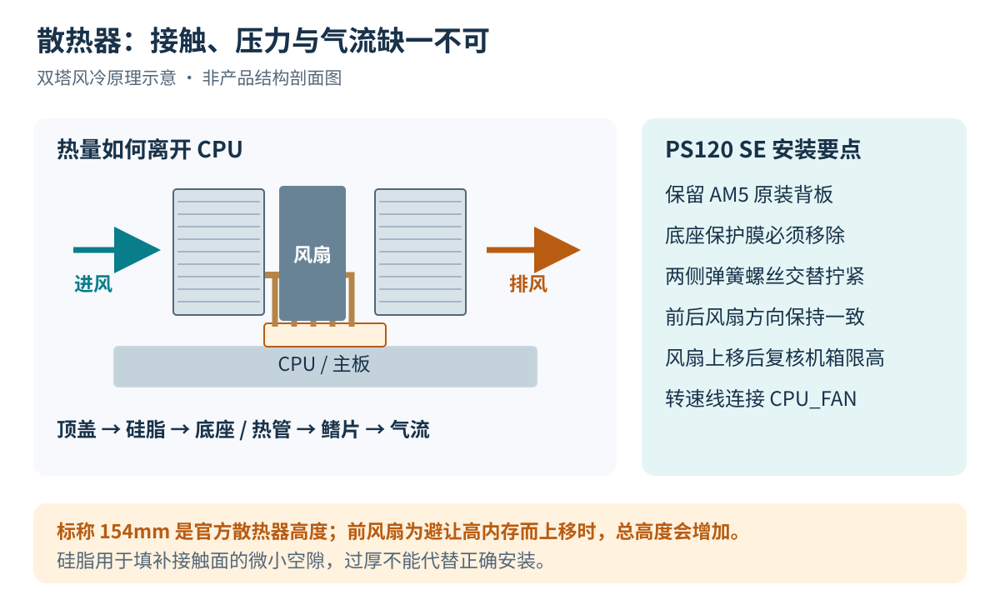

固定时先确认底座保护膜已经移除，再让底座平稳落在 CPU 上。两侧弹簧螺丝轮流、逐步拧紧，按说明规定的止点固定，不要把一侧先拧到底，也不要用过大扭矩继续硬拧。反复抬起、挪动后若要重装，应清理接触面并重新施涂硅脂。

两把风扇的送风方向应一致，让气流穿过鳍片并朝机箱排风方向流动。PS120 SE 的 4Pin 风扇线用于电机供电和 PWM 调速，ARGB 线用于灯光，二者分别连接。使用原配分线时，核对总电流与主板接口允许值；至少让 `CPU_FAN` 有正确的 CPU 风扇连接与转速反馈。另一把也可按说明接 `CPU_OPT`。[利民安装资料](https://download.thermalright.com/manuals/PHANTOMSPIRIT120SE.pdf)

## 主板入箱、供电与六把风扇

### 铜柱、螺丝和电源位置

机箱铜柱只应出现在主板固定孔对应位置。多余铜柱可能顶到 PCB 背面的焊点造成短路，缺少铜柱又会让主板受力不稳。先核对 M-ATX 孔位，再放入主板，确认后置 I/O 对齐。螺丝用机箱对应规格，固定到主板不晃动即可。

电源风扇应朝向机箱为电源设置的通风区域，不能机械地规定所有机箱都“朝下”。检查滤网、底部脚垫高度和进气空间，安装后确保线材没有压在风扇、玻璃或锋利边缘上。

CPU 供电线在主板左上方，双塔装好后可能比较难插，提前穿线会省很多事。连接 24Pin 主供电时，从适当位置托住主板边缘，防止过度弯曲。

### CPU 供电与显卡供电不能混用

| 线材或接口 | 用途 | 检查方法 |
| --- | --- | --- |
| ATX 24Pin，可能是 20+4 组合 | 主板主供电 | 接 `ATX_PWR`，卡扣与主板卡位对齐 |
| EPS / CPU 4+4Pin | CPU 供电 | 本板上方 `CPU_12V_1 / CPU_12V_2`，连接组合按手册要求 |
| PCIe 6+2Pin | 部分独立显卡的辅助供电 | 不插 CPU 供电座；当前无独显可先整理固定 |
| SATA 电源 | SATA 设备、部分集线器或控制器 | 不等同于 SATA 数据线 |

EPS 4+4Pin 和 PCIe 6+2Pin 即使拼起来都是 8 针，定义也不同。认线材上的 `CPU`、`EPS`、`PCI-E` 标记，不能靠外形接近就硬插。若以后使用模组电源，其电源端线序并不跨型号通用，只使用该电源明确兼容的线材。

### 前面板：先让开关、USB 和音频各归其位

机箱 `POWER SW` 接 `F_PANEL` 中说明书标定的电源按钮针脚。机械开关一般不分正负，电源灯和硬盘灯则通常有极性。插错灯的极性可能只是不亮，但不能在通电状态下逐针试插。

`RESET SW` 是否接主板复位针脚，要结合风扇控制器说明。有些装机方案把机箱复位键接到灯光控制器当切换按钮；同一个按钮不能同时按两种功能理解。

前置音频线接 `F_AUDIO`，不是插到 USB 接针。前置 USB 3.x Type-A 的大接头一般是 19 针结构，对齐缺口并直插，倾斜硬压容易损坏针脚。本板另有前置 Type-C 接针，但**主板提供接针，不代表机箱一定有对应开孔和线材**；本次机箱前面板按实物配置连接，不凭主板参数额外推定一个 USB-C。

### 正叶、反叶与进出风

本次购买的是 5 把反叶、1 把正叶。正反叶主要影响“从哪一面看是展示面”与气流方向的关系，不等于风扇安装到哪里都会自动进风或排风。优先查看风框上的气流箭头及型号说明；没有箭头时再用安全方式确认实际送风方向，不能仅凭灯圈、商标或支撑筋判断反叶风扇。

这类侧透机箱可以从底部、侧面引入冷空气，在后部、顶部安排排风。若机箱安装位允许，下面的“底部 3 进、侧面 2 进、后部 1 出”可作为这套风扇数量的规划示例；**现有照片不足以还原六把风扇的最终位置，因此本图不作为最终实装记录。**

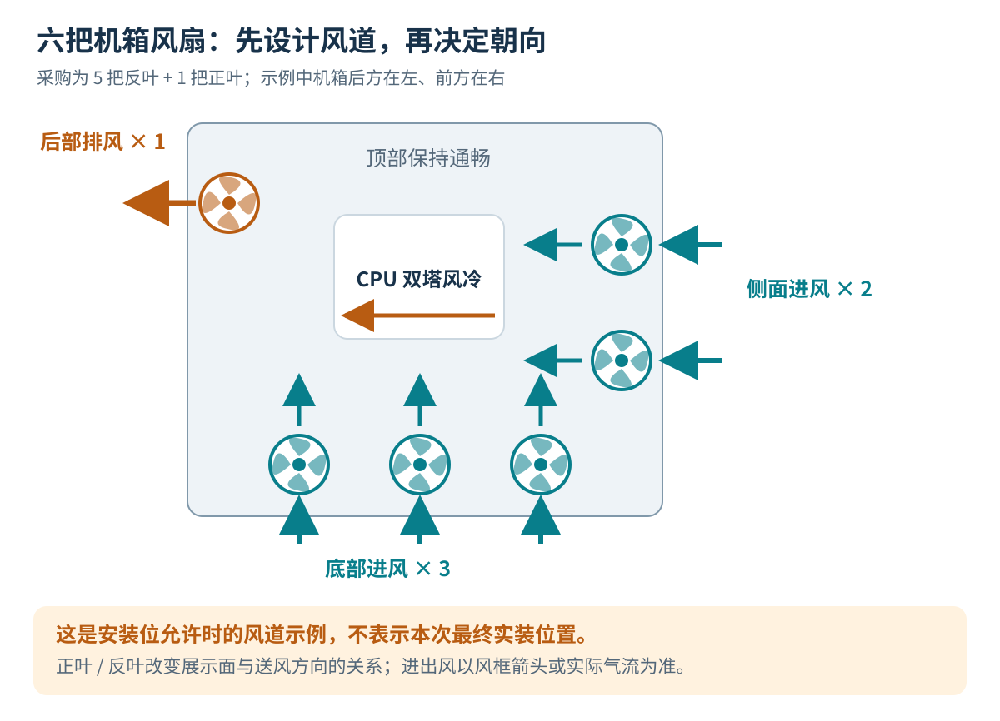

判断风道要看空气能否经过发热部件并排出去，而不只是数进风和排风风扇数量。转速、滤网阻力、开孔面积和风扇特性都会影响实际风量，五把进风加一把排风也不能直接证明一定是某种机箱压力。无独显时验证通过的风道，增加独显后还需要重新检查。

### 灯能亮，不代表风扇已经能正确调速

普通 ARGB 风扇常有两条独立线路：一条负责电机和转速，另一条负责灯光。

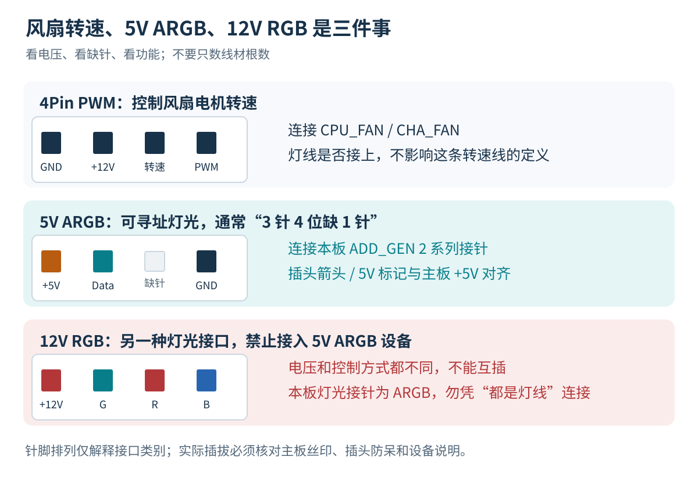

**5V ARGB 不能接到 12V RGB。** 常见 5V ARGB 是四个位置中缺一个针脚，12V RGB 则常见连续四针；但最终仍要检查 `5V`、`12V` 和接口功能标记。本板使用 `ADD_GEN 2` 系列可寻址灯光接针。4Pin PWM 风扇插头虽然也有四针，却不是灯光插头。

风扇控制器有时使用私有多针合并接口，不能把“6 针”“一根线”直接解释成标准 PWM 或 ARGB。按该套装的线序、输入输出方向和供电要求连接，不用不明转接线凑接口。

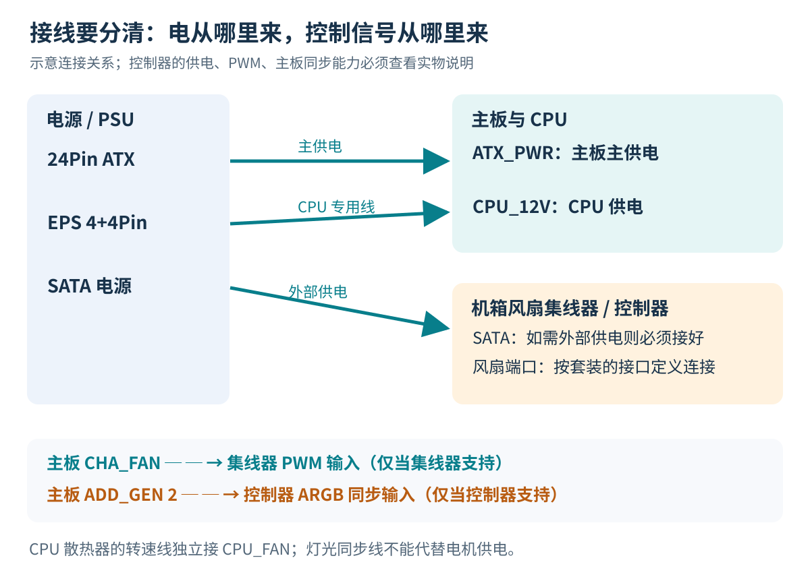

控制器是否支持主板 PWM 调速、主板灯光同步、SATA 外部供电，应分别确认。有 SATA 插头的控制器若要求外部供电，就不能只接一根主板同步线。反过来，接上 SATA 也不代表它已经能随 CPU 温度调速。

多把风扇不能无限并到同一个主板接针。查看风扇铭牌电流、主板单接口额定值，以及集线器单口和总负载上限，分别计算电机与灯光负载。许多 PWM 集线器只回传其中一个端口的转速，软件显示一组 RPM 并不表示其他风扇都停转。

理线时把线材固定到不会碰扇叶的位置，给接头留出适当余量。背板盖不上就检查线束和插头位置，不用盖板把线硬压平。

## 第一次开机：先观察自检，再调整 BIOS

### 通电前最后检查一次

确认 CPU 散热器已固定、底座保护膜已移除、CPU 风扇接好；内存、SSD、24Pin 和 CPU 供电完全到位；ARGB 电压无误；机箱内没有遗留螺丝或多余铜柱；所有风扇都没有被线材阻挡。

当前没有独显，显示器应接主板 HDMI 或 DP。7800X3D 自带 AMD Radeon Graphics，官方列出 2 个图形核心；“没买独显”不等于“没有核显”。它能承担装系统、桌面显示等工作，但不能把 CPU 的游戏能力直接当成核显能力，也不应在未测试时承诺某款游戏的帧率。[AMD 7800X3D 规格](https://www.amd.com/en/products/processors/desktops/ryzen/7000-series/amd-ryzen-7-7800x3d.html)

### AM5 首次内存训练可能需要等待

首次开机、清除 CMOS 或改变内存设置后，固件可能进行内存训练，为当前内存组合建立可用参数。期间可能黑屏、重启或在 DRAM 阶段停留一段时间，不应一看到黑屏就连续断电。

等待时间受 BIOS、内存容量和配置影响，没有一条适用于所有主板的固定秒数。观察本板 Q-LED 的变化，再按说明书判断是否长时间停在某个阶段。

| 持续停留的 Q-LED | 优先检查方向 |
| --- | --- |
| CPU，红色 | CPU 供电、CPU/BIOS 兼容性、安装情况 |
| DRAM，黄色 | 是否仍在训练，内存是否到位、是否使用 A2，超频配置是否合适 |
| VGA，白色 | 当前显示设备、输出连接和图形初始化 |
| BOOT，黄绿色 | 启动介质、系统与启动项；新机尚无系统时不宜据此判定 SSD 损坏 |

Q-LED 表示自检卡住的阶段，不是“亮哪个灯，哪个配件必坏”。排查按供电和连接、单条内存默认配置、说明书恢复步骤逐步进行，不要一上来就拆 CPU 或给插槽清针。[华硕 Q-LED 排查说明](https://www.asus.com/support/faq/1042678/)

### 第一次进入 BIOS 先看什么

开机按 `Del` 或 `F2` 进入 BIOS，检查 CPU 型号、24GB 内存是否识别、SSD 型号和容量、CPU 温度变化，以及 `CPU_FAN` 转速。BIOS 中温度不能直接和 Windows 空闲温度作一一比较；如果短时间持续快速升温，应先关机检查散热器接触和风扇。

初次启动先采用默认内存配置，确认能进入系统、基本运行稳定，再考虑 EXPO。用于 Windows 11 的启动环境采用 UEFI，按系统要求保持 TPM 与 Secure Boot 的正常配置，不为加快装机随意清除 TPM、删除安全启动密钥或切换到 Legacy/CSM。

BIOS 更新根据 CPU 支持、内存兼容性和厂商更新说明决定，不把“有新版”直接等同于“必须当场刷”。刷写要用本型号文件和可靠供电；系统已启用 BitLocker 或设备加密时，提前保存恢复密钥，并按厂商与微软要求暂停保护。本文没有完整记录本次是否刷写及其版本，因此不列出一段虚构的刷写过程。[微软固件更新与 BitLocker 说明](https://learn.microsoft.com/en-us/troubleshoot/windows-client/windows-security/suspend-bitlocker-protection-non-microsoft-updates)

### 第一天停在 BIOS，过夜前怎么关机

第一天装到能够进入 BIOS 后，系统留到第二天继续安装。停工时先确认没有正在刷写固件；BIOS 中的改动只保存自己确认需要保留的部分，再短按机箱电源键尝试关机。若短按无响应，可在当前无系统写入、无固件更新的前提下长按电源键关闭，不需要让电脑整晚停在 BIOS。

正常关机后，电源线可以保持连接；第二天继续插拔内部硬件前，仍要拨到 `O`、拔掉交流电源并等待待机灯熄灭。Windows 安装完成后，日常关机使用系统菜单，长按电源键只留作无响应时的处理方式。

## 准备启动盘：把旧微 PE U 盘改为 Ventoy

### 这只 64GB U 盘原来是什么状态

本次使用的 U 盘标称 64GB，没有需要保留的个人文件。但实际检查时，发现它并不是一整块普通数据分区，而是曾用于启动盘的布局：

| 原分区 | 记录容量 | 文件系统 |
| --- | ---: | --- |
| E: | 32.00GB | exFAT |
| F: | 26.01GB | exFAT |
| 隐藏的 `EFI(2)` | 298MB | FAT16 |

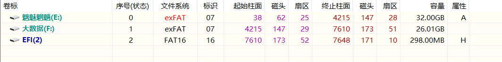

单凭一个名为 EFI 的分区，不能确定它是 WinPE。继续查看隐藏分区后，看到了 `EFI` 和 `WEPE` 文件夹，说明存在旧微 PE 相关文件；真正能否正常启动，仍要实际启动验证。普通分区中的 `FOUND.000`、`System Volume Information` 不能作为装有 PE 的证据。

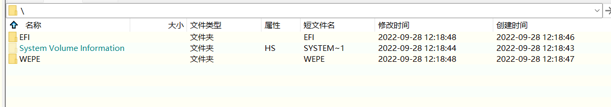

### 为什么选择 Ventoy

Ventoy 先在 U 盘建立启动环境，以后把 ISO 作为普通文件复制进去，就能从菜单选择启动。Windows 安装镜像、PE 镜像与普通文件可以共享大数据分区；不需要给每个镜像单独切一块空间。删除一个 ISO，就能释放它占用的容量。[Ventoy 使用说明](https://www.ventoy.net/en/doc_start.html)

这适合本次“现在装 Windows 11、以后可能增加 Ubuntu、平时仍能存文件”的需求。传统安装介质也可用于装系统，只是 Ventoy 更便于管理多个镜像。

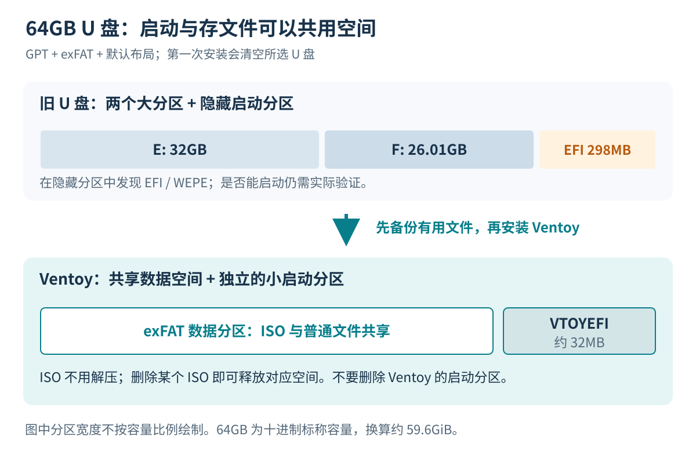

### 制作步骤与空间安排

1. 先检查旧 U 盘所有分区，将有用文件复制到另一块磁盘。若想保存旧 PE 文件，可一并备份 `EFI`、`WEPE`，但文件夹备份不等于可直接恢复的启动盘镜像。
2. 从 [Ventoy 官方下载页](https://www.ventoy.net/en/download.html) 获取 Windows 压缩包，解压并运行 `Ventoy2Disk.exe`。
3. 按型号和容量核对目标设备，选择 GPT 分区表、默认 exFAT 数据分区，并按官方说明检查 Secure Boot Support。
4. 不额外预留独立数据分区，使用默认布局。确认清空的是这只 U 盘后执行首次安装。
5. 将 Windows 11 x64 ISO 复制到大数据分区，不解压，不再使用另一个工具重复写盘。

**首次安装 Ventoy 会清空所选 U 盘。** 它会重新建立自己的布局，没有必要先用 DiskGenius 手动删除 E、F、EFI 三个分区。默认布局含一个大数据分区和约 32MB 的小启动分区，小分区不是浪费空间，不要删除。[Ventoy GPT 布局说明](https://www.ventoy.net/en/doc_disk_layout_gpt.html)

标称 64GB 按二进制换算约 59.6GiB，再扣除启动分区、文件系统等开销。ISO 大小随版本变化，不能把某个示例容量当成固定占用。文件可以这样分类，名称仅作示例：

```text
Ventoy (U:)
├── ISO/
│   ├── Windows11_x64.iso
│   ├── WePE_x64.iso
│   └── ubuntu-desktop.iso
├── Drivers/
├── Software/
└── Documents/
```

Ubuntu 不急着下载。需要 PE 时，通过微 PE 工具生成新的 ISO，再复制到 `ISO` 目录；不要再次把微 PE 直接安装到这只已制作 Ventoy 的 U 盘上，避免覆盖现有引导。旧 `WEPE` 文件夹也不应被当成可以直接启动的 ISO。

## 安装 Windows 11，并给以后留出扩展余地

### 选对下载项：x64 ISO

新主机使用 AMD x86-64 处理器，选择微软页面中“适用于 x64 设备的 Windows 11 磁盘映像（ISO）”，不是 Arm64 镜像，也不是用于已有 Windows 环境升级的安装助手。家庭版和专业版按已有授权及所需功能选择，WSL2 本身不要求必须使用专业版。

下载版本、镜像哈希和安装要求以当时的微软页面为准；官网当前展示的版本不能用来反推本次实际安装的小版本。页面提供 SHA-256 校验值时，可在用于制作 U 盘的 Windows 电脑上核对：

```powershell
Get-FileHash -LiteralPath 'D:\Downloads\Windows11_x64.iso' -Algorithm SHA256
```

把路径替换为实际镜像位置，并与官方对应语言、版本的校验值比较。只运行命令但不比较结果，不能说明镜像已校验。[微软 Windows 11 下载页](https://www.microsoft.com/zh-cn/software-download/windows11)

### 从 U 盘启动，而不是修改硬盘里的文件

插入启动 U 盘，开机按华硕主板常用的 `F8` 打开启动菜单，选择对应的 UEFI USB 启动项，再在 Ventoy 菜单中选择 Windows ISO。也可以在 BIOS 的启动覆盖菜单中选择。

若启用了 Secure Boot，Ventoy 在某些电脑首次启动时会要求按官方流程注册相关证书，固件也可能涉及 Microsoft 第三方 UEFI CA 选项。具体情况按 [Ventoy Secure Boot 说明](https://www.ventoy.net/en/doc_secure.html) 处理，不要把任何安全启动报错都当成需要清空密钥。无法兼容时可改用微软官方安装介质方案。

### 安装目标一定要认准 1TB SSD

进入安装程序后，按当次界面选择全新安装流程。只在明确允许清空的目标 SSD 上新建或删除分区，识别依据是型号、容量和实际设备，不能假定任何电脑中的“磁盘 0”都一定是系统盘。其他外接存储和旧数据盘若不参与安装，可在断电状态下先断开以减少误操作。

本次要安装的是致态 1TB SSD，64GB Ventoy U 盘是启动介质，二者不能选反。在 UEFI 启动下使用 GPT，安装程序会创建所需系统分区。第一次自动重启后，让电脑从 SSD 的 Windows Boot Manager 启动；如果又进入 Ventoy 菜单，改选内置 SSD 启动项，不要重新开始一遍安装。[微软 UEFI/GPT 安装说明](https://learn.microsoft.com/en-us/windows-hardware/manufacture/desktop/windows-setup-installing-using-the-mbr-or-gpt-partition-style?view=windows-11)

### 1TB SSD 要不要分 C / D

1TB 按 `10^12 ÷ 2^30` 换算约为 931.3GiB。Windows 中常见的约 931“GB”显示，主要涉及计量单位差异，再加上系统分区与文件系统开销，不代表少了一块容量。

分区主要用于管理。只保留一个大的 C 盘，靠文件夹区分系统、软件、项目和游戏，可以减少日后“C 盘不够、D 盘剩很多”的问题；分 C / D 则便于按用途分类。对开发机而言，还要考虑 `AppData`、WSL 虚拟磁盘、容器和软件缓存可能增长，不能仅按 Windows 初装占用决定 C 盘大小。

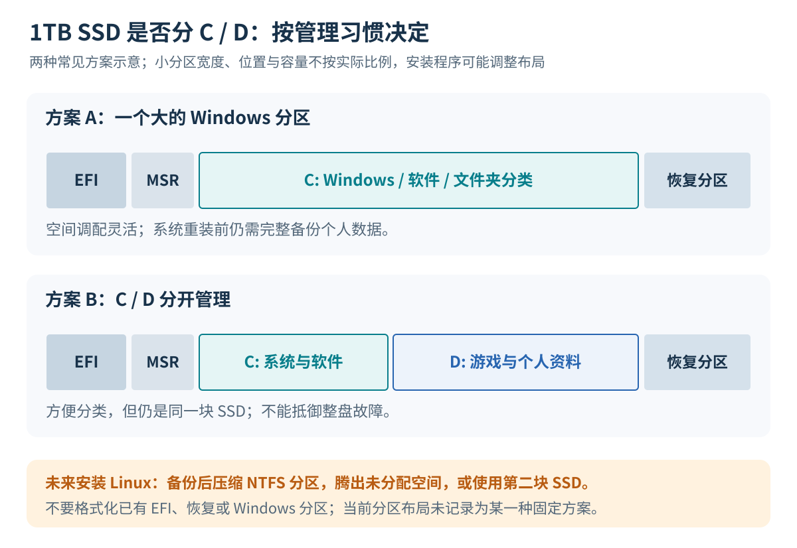

之前讨论过 C 盘约 350GB、其余作 D 盘的方案，但没有足够记录确认最后采用哪种布局，因此这里只保留为规划参考。分区不会让 SSD 本身更快，同一块盘上的 D 盘也不能抵御整盘故障。重装时“资料留在 D 盘”不能代替外部备份。

### 先装 Windows，以后仍可增加 Ubuntu

现在安装 Windows 11 不会失去以后安装 Linux 的机会。如果尚未确定使用原生 Linux 的时间，可以先正常使用空间；以后备份后用 Windows 磁盘管理压缩 NTFS 分区，腾出未分配空间，或者增加第二块 SSD。压缩空间会受分页文件、卷影副本等不可移动文件影响，不能保证想压多少就能压多少。[微软压缩卷说明](https://learn.microsoft.com/windows-server/storage/disk-management/shrink-a-basic-volume)

真正安装双系统之前，要保存 BitLocker/设备加密恢复密钥，按需要暂停保护；两个系统都使用 UEFI 安装，避免误格式化 Windows、EFI 和恢复分区。涉及 Linux 访问 Windows NTFS 数据时，还要处理 Windows 快速启动和休眠状态，不在 Windows 休眠时强行写入其分区。

若只是学习 Linux 命令、运行开发工具，先使用 WSL2 也可以。它与以后安装的原生 Ubuntu 是独立环境，文件和软件不会自动同步。这里不展开双系统或 WSL 的完整部署，避免把一次装机记录写成多套系统教程。[微软 WSL 安装说明](https://learn.microsoft.com/en-us/windows/wsl/install)

## 接口与联网：这次实际问到的几个问题

### 主板后面的 5G、10G、20G 是什么

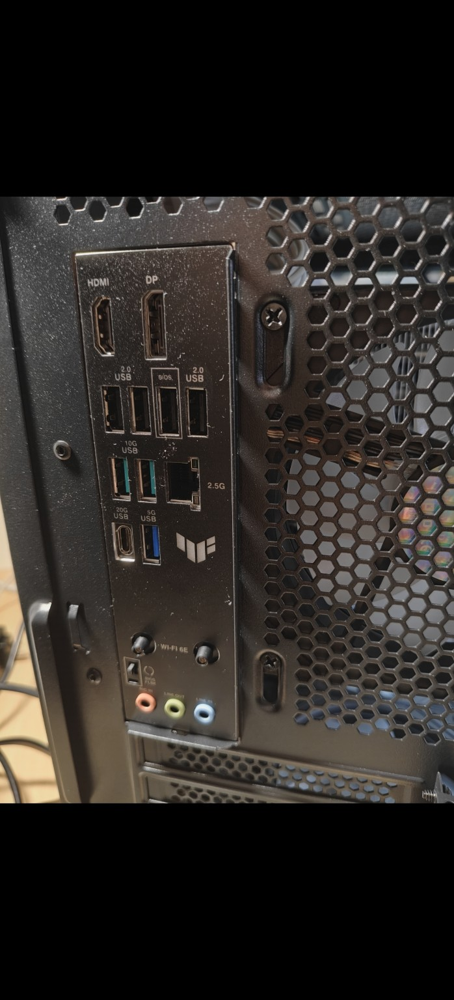

照片中的 USB `5G`、`10G`、`20G` 表示标称数据传输速率，单位是 Gbps，和手机蜂窝网络的 5G 不是一回事。按 `1Byte = 8bit` 换算，再考虑编码和协议开销，实际文件复制速度会低于直接除以 8 的数值。

| 这块主板的后置接口 | 数量 | 常见用途 |
| --- | ---: | --- |
| USB 2.0 Type-A | 4 | 键盘、鼠标等；标称 480Mbps |
| USB 5Gbps Type-A | 1 | U 盘、普通外接存储 |
| USB 10Gbps Type-A | 2 | 高速存储、USB 数据设备 |
| USB 20Gbps Type-C | 1 | 支持对应速率的外接设备 |
| HDMI / DisplayPort | 各 1 | 当前核显的视频输出 |
| 2.5Gb Ethernet | 1 | 有线局域网，实际速率受对端和网络链路限制 |
| Wi-Fi 天线连接位置 | 按附带天线连接 | 配合无线网络和蓝牙使用 |
| 3.5mm 音频接口 | 3 | 按背板标识接麦克风、音箱、线路输入 |

数据核对自 [华硕本型号规格页](https://www.asus.com/motherboards-components/motherboards/tuf-gaming/tuf-gaming-b650em-plus-wifi/techspec/)。`Type-A`、`Type-C` 描述外形，数据速率、PD 供电和视频输出是另外的能力；不能仅因为有 USB-C，就认为它支持雷电、显示器输出或某种快充功率。

机箱前置接口还多了一段内部线缆。设备、线材、机箱接口和主板接针的共同能力决定最终效果。本板前置 Type-C 接针为 5Gbps，后置 Type-C 为 20Gbps，不能相互套用。后置 USB 的颜色也不应被当成跨品牌通用的规格标准。

照片拍摄时天线尚未连接。实际使用 Wi-Fi 和蓝牙前，应接好主板附带天线，不能只装驱动而忽略天线。以后添加独显后，若要使用独显渲染输出，显示线也应接到独显的 HDMI/DP 接口。

### 中兴 F50 通过 USB 给新机联网

本次讨论的目标是让 F50 通过 USB 提供网络。它不是显示设备，不需要视频口；使用支持数据传输的线，连接主板后置 USB 数据接口即可，优先从 5Gbps 或 10Gbps 接口尝试，没有必要为了“蜂窝 5G”专门占用 20Gbps USB-C。

连接后，在 Windows 的网络设置或设备管理器中确认是否出现新的 USB 网络适配器。若没有识别，依次检查线是否只有充电功能、设备是否进入正确 USB 联网模式、供电是否稳定，以及该固件是否需要对应驱动。设备可能以不同 USB 网络类别枚举，不保证一定叫 `Remote NDIS`，也不假定首次安装向导一定免驱可用。

因此，制作启动盘时预先放入本主板对应的有线或无线网卡驱动很有用。F50 是本次讨论的联网方式，不把每个固件和每台 Windows 上的自动识别都写成已经验证的事实。

## 系统装好后：驱动、EXPO、风扇和机箱屏幕

### 先补齐驱动，再看设备管理器

进入 Windows 桌面后，先解决网络，再安装匹配的 AMD 芯片组、Radeon 核显和主板设备驱动，完成 Windows Update，并在需要时重启。它们处理的问题不同：芯片组驱动不等于核显驱动，能显示桌面也不证明图形驱动和所有设备都已就绪。

| 项目 | 来源和检查点 |
| --- | --- |
| AMD B650 芯片组 | AMD 或华硕对应型号支持页，选择匹配操作系统 |
| Radeon 核显 | AMD 对应处理器图形驱动，检查设备识别 |
| 有线、Wi-Fi、蓝牙、音频 | 华硕本型号支持页，核对实际设备和系统 |
| Windows 更新 | 安全更新及适用的设备更新 |
| 机箱副屏 | 瓦尔基里官方对应机型的软件和说明 |

可以从 [AMD 驱动入口](https://www.amd.com/en/support/download/drivers.html) 及主板官方支持入口查找。装完检查设备管理器是否有未知设备、异常标记，再分别试网络、蓝牙、前后置 USB 和音频。暂时没有 NVIDIA 独显，不需要为了未来计划预装其驱动。

### EXPO：载入一套参数，再验证它

内存包装写着 DDR5-6000，不表示第一次开机会自动以 6000MT/s 运行。SPD 中包含基本参数，EXPO 提供一组超频配置，通常涉及传输率、时序和电压。是否能稳定使用，仍取决于内存、CPU 内存控制器、主板、BIOS 和插条组合。

本次后续记录为启用 `EXPO I`。华硕 AM5 平台常见路径是 `F7` 进入高级模式，在 `Ai Tweaker → Ai Overclock Tuner` 中选择内存支持的 EXPO 配置，再核对变更、按 `F10` 保存。菜单随 BIOS 和内存配置文件变化；只带 XMP 的内存在相关平台上可能显示 DOCP，不应强求一个不存在的 EXPO 选项。[华硕 EXPO 设置说明](https://www.asus.com/me-en/support/faq/1042256/)

调整后再次内存训练属于可能出现的过程。进入系统后检查容量、速度，并做内存压力测试。如果出现报错、蓝屏、冷启动失败等情况，先恢复默认内存配置对比，再考虑兼容性与 BIOS，不用盲目提高 SoC 或 DRAM 电压。AMD 官方对 7800X3D 的常规内存支持规格与 DDR5-6000 超频配置需要区分，不能把后者当成无条件保证。

### 风扇曲线先保证工作，再优化噪声

确认 CPU 风扇有转速反馈，机箱风扇能够按其连接方式调节，再通过 BIOS 的风扇控制功能设置合适曲线。4Pin PWM 风扇应匹配 PWM 控制模式；若经控制器连接，控制器也必须支持相应信号。

不要仅为了消除提示，把 CPU 风扇检测直接设成忽略。也不宜一开始就追求极低转速：先确认负载下温度和转速变化正常，再逐步调整曲线、延迟与噪声。RGB 软件主要处理灯光，不能凭灯光同步正常就判定温控已经配置完成。

### 副屏显示 LOGO 与局部温热

本次在安装系统前，VK03M 屏幕已经能显示 VALKYRIE 标志。当时提出“一边很烫”，进一步确认后的描述是**屏幕正面玻璃右侧温温的**，没有记录到闪屏、变色或异味。这里保留后来的具体描述，避免把“温热”和“明显烫手”混在一起。

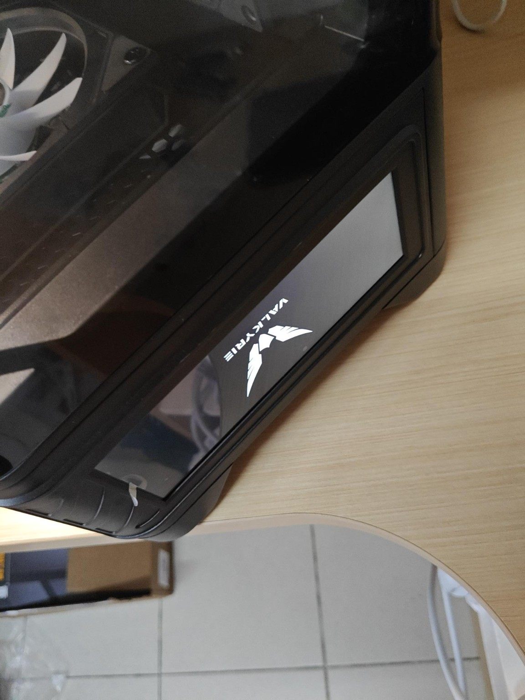

屏幕通电后，背光和电路会产生热量，局部温热本身不能直接说明损坏；但照片和手感都不能测出准确温度，也不能据此断定驱动芯片一定装在右侧。若出现持续加剧的明显烫手、异味、闪屏或局部变色，应停机断电，按厂商要求检查或联系售后，不自行拆屏。

显示固定 LOGO 只能确认屏幕有某种显示输出，不代表主机传感器数据已经接通。安装 Windows 后，按机型说明检查内部连接和软件。瓦尔基里官网列有适用于多种副屏产品的 Myth.cool，但 VK03M 的具体硬件版本、接线及支持范围仍需核对，不把外形为 Type-C 的连接一律当成 HDMI 或 USB-C 视频输入。[瓦尔基里软件入口](https://www.valkyrie.com.cn/index.html?page=2)

## 第一次验收：OCCT CPU 测试记录

### 这次具体使用了什么设置

本次照片中的版本为 **OCCT Personal 17.1.10**，选择的是 `CPU` 项目，不能和 `CPU + RAM`、`MEMORY`、`POWER` 混为一谈。界面选项以该版本照片为依据，未来版本可能调整名称和布局。

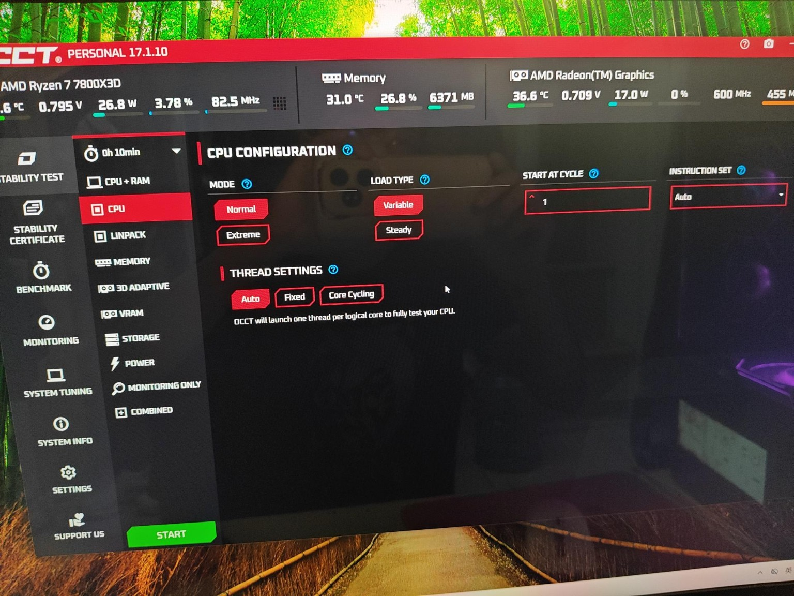

| 参数 | 本次设置 |
| --- | --- |
| Test | CPU |
| Duration | 10 分钟 |
| Mode | Normal |
| Load Type | Variable |
| Start at Cycle | 1 |
| Instruction Set | Auto |
| Thread Settings | Auto |

这是首次 CPU 散热与基础稳定性检查的参数记录，不是所有电脑通用的最佳测试模板。不要因为其他教程有 `Data Set`，就在这个 CPU 页面里反复寻找并不存在的同名选项。OCCT 的项目与版本信息可以从 [官方入口](https://www.ocbase.com/) 查询。

本次启动前还遇到赞助提示窗口，等待提示并点击允许继续测试的 `START` 后，才进入真正负载阶段。看到配置页或赞助页不能算已经开始烤机；以运行计时、负载和测试日志共同判断。

### 运行中的画面该怎么看

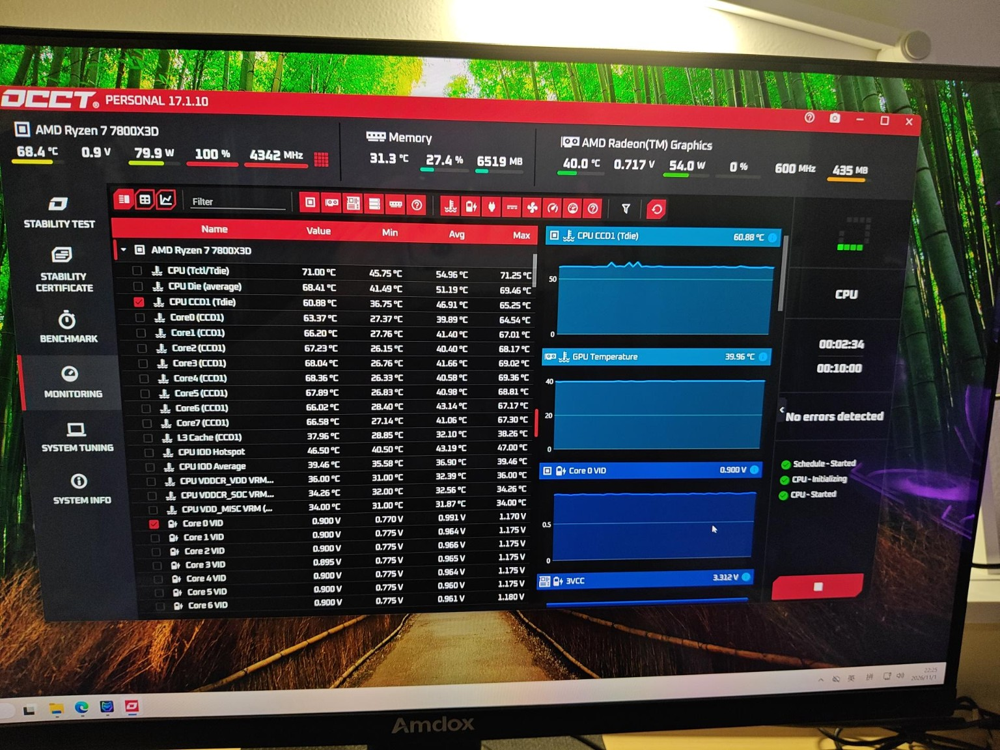

这张照片记录了约 `02:34 / 10:00` 的状态：CPU 使用率 100%，CPU 栏功耗约 79.9W、频率约 4342MHz，右侧未检测到错误。这是一个时间点的读数，不是整段测试的固定功耗，也不是插座测得的整机功耗。

CPU 使用率 100% 表示调度到的计算资源处于高负载，不要求功耗一定等于产品 TDP。算法、指令集、负载类型和频率策略会改变功耗。

同一画面中的顶部温度和传感器列表也可能不是同一测点。`CPU (Tctl/Tdie)`、`CPU Die (average)`、`CPU CCD1 (Tdie)` 不能混着比较。记录温度时带上传感器名称和 `Value / Min / Avg / Max` 列，比只说“CPU 现在 68 度”更清楚。

### 最终结果，以及它能证明什么

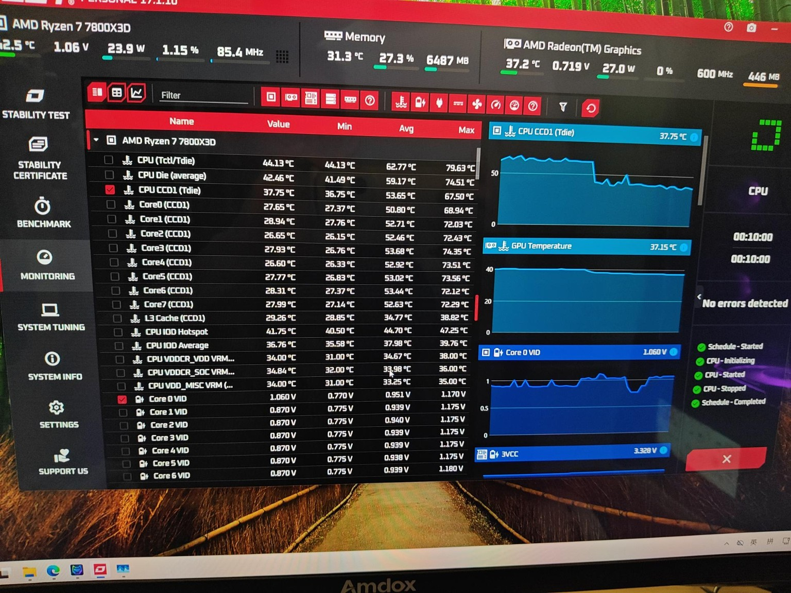

最终照片中可以看到 `CPU - Stopped`、`Schedule - Completed` 和 `No errors detected`，计时达到 10 分钟。

| 传感器 | 截图统计窗口 Avg | 截图统计窗口 Max |
| --- | ---: | ---: |
| CPU (Tctl/Tdie) | 62.77°C | 79.63°C |
| CPU Die (average) | 59.17°C | 74.51°C |
| CPU CCD1 (Tdie) | 53.65°C | 67.50°C |

这里专门写成“截图统计窗口”：没有记录监控统计在何时重置，`Avg` 可能覆盖测试前后的空闲时段，**不能直接称为严格意义上的 10 分钟满载平均温度**。最高温度也应结合统计范围理解，不把它作为另一台机器的标准成绩。

AMD 为 7800X3D 列出的最高工作温度 `Tjmax` 为 89°C。本次记录中的 `Tctl/Tdie` 最高值低于该规格，且本轮 OCCT 未报错，可以认为这套散热和 CPU 配置通过了本次初步检查。室温、风扇曲线、传感器统计重置点等没有完整记录，不据此推广成散热器横向评测。

89°C 不是建议追逐的目标，也不是超过某个人为设定值就必然损坏。首次测试可以自行设置更保守的提醒或停测阈值；若温度迅速接近上限、风扇停转、出现错误、异常重启或异味，应停止并排查，而不是只等倒计时结束。

**这轮测试的结论是“CPU 初步检查通过”，不能扩大为“整机长期稳定性已完全验证”。** 特别是：

- CPU 测试不能替代 EXPO 下的专门内存测试。
- OCCT 显示零错误，不等于已经单独核查过全部 WHEA 系统事件。
- 当前没有独显，不能据此证明未来 CPU 与独显同时负载时的供电和温度表现。
- 10 分钟没有异常，不能排除长时间运行、冷启动、睡眠恢复等条件下的问题。

下一步适合检查内存、SSD 健康状态，以及日常实际负载。内存测试可以按工具说明选择能留下系统余量的占用量，从一轮较短检查开始，再根据使用场景延长；此前讨论的 30～60 分钟可作为下一轮计划，不写成已经完成。停止 CPU 测试后可以正常关闭 OCCT，不必等 CPU 完全冷却再关软件。

## 这次值得留下的排查方法

| 现象 | 从哪里开始看 | 避免的误判 |
| --- | --- | --- |
| 按开机键完全没反应 | 交流供电、电源开关、24Pin、CPU 供电、`POWER SW` | 不先认定主板或电源损坏 |
| 首次黑屏、DRAM 灯停留 | 内存训练、A2 安装、默认配置 | 不连续强制断电打断训练 |
| 风扇转但灯不亮 | 电机线与灯线分开查，核对 5V 和控制器供电 | 不拿 12V RGB 反复试插 |
| 灯能变色但转速不变 | PWM 接线、控制器能力、BIOS 控制模式 | 不把灯光软件当成转速控制已完成 |
| 前置 USB 无法使用 | 机箱内部对应接头、方向、设备与线材 | 不只因为后置正常就认定系统有问题 |
| U 盘能存 ISO 但不能启动 | UEFI 启动项、Ventoy 安装、Secure Boot 兼容性 | 不以“文件复制成功”代替启动验证 |
| Windows 安装后总回 Ventoy | 内置 SSD 的 Windows Boot Manager | 不重新分区、重复安装 |
| 6000 内存显示较低速度 | 实际运行配置、EXPO/DOCP 与训练结果 | 不直接认定买到假内存 |
| 核显表现不符合网上视频 | 游戏版本、画质、分辨率、驱动和单双通道条件 | 不照搬其他配置的帧率 |
| 机箱屏幕右侧温热 | 具体温感、显示状态、连接与厂商说明 | 不凭手感给出温度，也不推定内部布局 |

排查时每次只改变一个关键条件，并记下改变前后的表现。先核对供电、接口和默认设置，再考虑更新固件、替换配件，通常比一次改很多 BIOS 选项更容易找到原因。

## 组装完成后还要检查什么

装机完成后，除了跑分，还要实际使用各类接口：前后置 USB、音频输入输出、网络、Wi-Fi、蓝牙、机箱按钮和屏幕都应分别检查。再观察关机、冷启动、重启、睡眠和唤醒是否正常，负载变化时有没有异响或风扇碰线。

为以后维护留下一份简短记录：CPU 与主板型号、BIOS 版本、内存容量与启用配置、驱动来源、测试模式和时长、温度传感器名称，以及新增硬件前后的变化。照片中的硬件型号、连接关系和测试结果，比只存一张“全绿”截图更有用。

安装 Windows 后还应确认激活状态与授权版本，检查设备加密/BitLocker 状态，并把恢复密钥保存到可以在这台电脑无法开机时访问的位置。以后调整 BIOS、TPM、分区或双系统引导之前先备份，不把恢复密钥只存到同一块加密磁盘上。[微软恢复密钥说明](https://support.microsoft.com/en-us/windows/security/encryption/find-your-bitlocker-recovery-key)

这台机器接下来的重点，是补充 EXPO 内存验证、整理驱动与环境，再按需要增加独显。以后加显卡时，重新核对显卡长度与供电、把显示线转接到独显，并在新的实际负载下复查温度和风道。保留当前默认配置和首次测试记录，之后遇到问题时才有清楚的对照。

## 参考资料

- [AMD Ryzen 7 7800X3D 产品规格](https://www.amd.com/en/products/processors/desktops/ryzen/7000-series/amd-ryzen-7-7800x3d.html)：平台、内存、核显与温度规格。
- [华硕 B650EM-PLUS WIFI 规格](https://www.asus.com/motherboards-components/motherboards/tuf-gaming/tuf-gaming-b650em-plus-wifi/techspec/)与[说明书入口](https://www.asus.com/uk/motherboards-components/motherboards/tuf-gaming/tuf-gaming-b650em-plus-wifi/helpdesk_manual?model2Name=TUF-GAMING-B650EM-PLUS-WIFI)：接口、布局和安装约定。
- [华硕 Q-LED 排查](https://www.asus.com/support/faq/1042678/)与[EXPO/XMP/DOCP 设置](https://www.asus.com/me-en/support/faq/1042256/)：自检和内存配置。
- [利民 PS120 SE ARGB 产品页](https://www.thermalright.com/product/phantom-spirit-120-se-argb/)与[安装资料](https://download.thermalright.com/manuals/PHANTOMSPIRIT120SE.pdf)：尺寸、扣具和风扇接线；以随盒对应版本说明为准。
- [Kingston DDR5 技术说明](https://media.kingston.com/kingston/articles/MKF_954-DDR5-Collateral_us.pdf)：子通道和内存结构。
- [长江存储致态 TiPlus7100s 参数](https://www.ymtc.com/cn/products/72.html?cat=44)：SSD 形态、接口和规格。
- [Ventoy 入门](https://www.ventoy.net/en/doc_start.html)、[GPT 布局](https://www.ventoy.net/en/doc_disk_layout_gpt.html)与[Secure Boot](https://www.ventoy.net/en/doc_secure.html)：启动盘制作与兼容性。
- [微软 Windows 11 下载](https://www.microsoft.com/zh-cn/software-download/windows11)与[UEFI/GPT 安装说明](https://learn.microsoft.com/en-us/windows-hardware/manufacture/desktop/windows-setup-installing-using-the-mbr-or-gpt-partition-style?view=windows-11)：镜像和安装方式。
- [微软压缩卷说明](https://learn.microsoft.com/windows-server/storage/disk-management/shrink-a-basic-volume)与[BitLocker 固件更新注意事项](https://learn.microsoft.com/en-us/troubleshoot/windows-client/windows-security/suspend-bitlocker-protection-non-microsoft-updates)：后续分区和固件维护。
- [瓦尔基里官方软件入口](https://www.valkyrie.com.cn/index.html?page=2)与[OCCT 官网](https://www.ocbase.com/)：副屏软件和验收工具。
