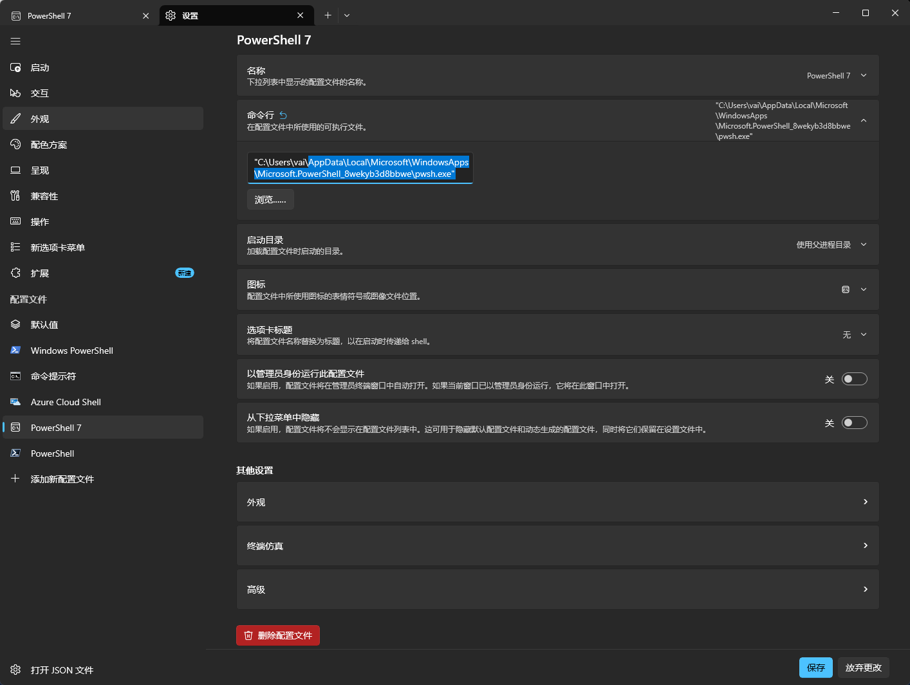
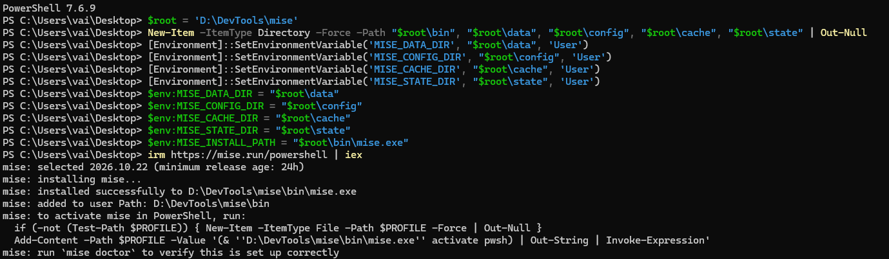
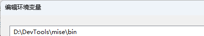
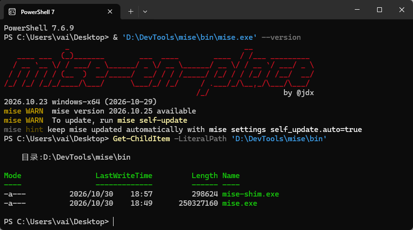
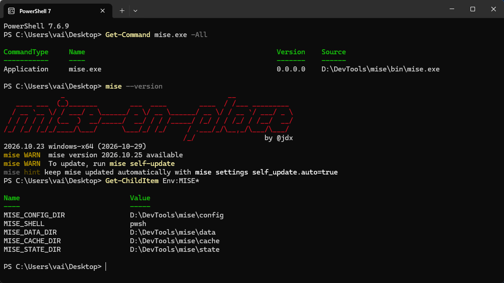


[mise 常用指令速查](#mise-常用指令速查)


开发多个项目时，经常需要不同版本的 Node.js 和 JDK。mise 可以把版本选择写进项目配置：进入项目使用对应版本，离开项目恢复其他目录或全局配置指定的版本。

本文以 Windows、PowerShell 7 为环境，将 mise 安装到 `D:\DevTools\mise`，介绍安装、Shell 激活、Node.js 与 Java 管理，以及按项目自动切换。除明确标注为 Git Bash 的代码外，命令均在 PowerShell 7 中执行。安装前需要能够写入目标目录，并能访问 mise、Node.js 和 JDK 的下载服务。

资料核对日期：2026-10-31。Node 以 24 主版本、Java 以 Temurin 21 为示例，具体版本应结合项目要求选择。

## 先理解三个概念

mise 的日常使用可以分成三件事：

1. **安装 mise 程序**：获得 `mise.exe`。
2. **安装并选择工具版本**：例如 Node 24、Temurin JDK 21。
3. **激活 Shell**：让 PowerShell 在切换目录后更新当前环境。

只安装 `mise.exe`，还不能让每个项目自动使用正确版本。项目需要声明版本，PowerShell 也需要加载激活配置。

全局配置提供个人默认值，项目配置声明项目需求。例如，全局使用 Node 24，某个项目声明 Node 22，进入该项目便使用 Node 22。[官方使用说明](https://mise.jdx.dev/cli/use.html)

### 自动切换究竟切换了什么

可以同时安装多个 Node 或 JDK，真正需要随项目变化的是当前 Shell 的命令查找路径和相关环境变量。比如运行 `node` 时，Shell 会根据命令解析规则寻找可执行文件；mise 激活脚本会把所选 Node 的路径放入当前环境，让接下来的命令使用它。

在普通配置下，可以将这个过程理解为：

```text
进入项目目录
    → mise 根据当前目录及上层配置解析工具版本
    → Shell 激活钩子更新 PATH、JAVA_HOME 等环境
    → node、java 等命令使用所选工具
```

因此，`mise.toml` 负责声明需求，工具安装目录保存实际程序，Shell 激活负责把两者连接起来。版本切换不会修改项目源码，也不会替换整台电脑唯一的一份 Node。

交互终端适合使用激活；自动化脚本可以用 `mise exec` 显式构造运行环境。shims 则是在固定目录中提供命令代理，由代理解析实际工具；它们与 Shell 激活的能力不同，不能仅靠把 shims 加入 PATH 就认为当前 Shell 中的所有环境变量都会同步更新。[Shell 激活与其他入口](https://mise.jdx.dev/shell-setup.html)

## 准备 PowerShell 7

打开日常使用的终端，检查版本：

```powershell
$PSVersionTable.PSVersion
```

本文使用 PowerShell 7。Windows 自带的 Windows PowerShell 5.1 与 PowerShell 7 是两个独立程序，对应的 Profile 文件也不同。

如果尚未安装 PowerShell 7，可以执行：

```powershell
winget install --id Microsoft.PowerShell --source winget
```

安装后从开始菜单打开 PowerShell 7，或运行 `pwsh`。Windows Terminal 用户也可以在设置中将“默认配置文件”改为 PowerShell 7。[微软 PowerShell 安装说明](https://learn.microsoft.com/powershell/scripting/install/installing-powershell-on-windows)




## 规划 DevTools 目录

本文使用以下结构：

```text
D:\DevTools\mise\
├── bin\       mise.exe、mise-shim.exe
├── data\      Node、JDK、插件、shims 等数据
├── config\    全局配置
├── cache\     缓存
├── state\     本机状态与信任记录
└── tmp\       mise 临时文件
```

目录与变量的对应关系：

| 变量 | 本文取值 | 用途 |
| --- | --- | --- |
| `MISE_INSTALL_PATH` | `D:\DevTools\mise\bin\mise.exe` | 安装器的程序目标路径 |
| `MISE_DATA_DIR` | `D:\DevTools\mise\data` | mise 管理的工具数据 |
| `MISE_CONFIG_DIR` | `D:\DevTools\mise\config` | 全局配置 |
| `MISE_CACHE_DIR` | `D:\DevTools\mise\cache` | 缓存 |
| `MISE_STATE_DIR` | `D:\DevTools\mise\state` | 本机状态 |
| `MISE_TMP_DIR` | `D:\DevTools\mise\tmp` | mise 临时文件 |

**程序安装位置与工具安装位置需要分别设置。** 只指定 `MISE_INSTALL_PATH`，不会同时改变 Node 和 Java 的安装目录。

这些目录变量应在运行 mise 前设置，不要放在 `mise.toml` 的 `[env]` 中。目录之间保持分离，尤其不能让 cache 与工具数据共用同一个目录。[官方目录说明](https://mise.jdx.dev/directories.html)

项目本身仍放在代码目录；npm 缓存、IDE 配置等由各自的软件管理，不会因为设置这些变量而全部迁入 DevTools。

## 自定义路径安装 mise

### 创建目录并设置变量

在普通 PowerShell 7 中执行：

```powershell
$miseRoot = 'D:\DevTools\mise'

foreach ($part in 'bin','data','config','cache','state','tmp') {
    New-Item -ItemType Directory -Force -Path (Join-Path $miseRoot $part) | Out-Null
}

$miseDirectories = @{
    MISE_DATA_DIR   = "$miseRoot\data"
    MISE_CONFIG_DIR = "$miseRoot\config"
    MISE_CACHE_DIR  = "$miseRoot\cache"
    MISE_STATE_DIR  = "$miseRoot\state"
    MISE_TMP_DIR    = "$miseRoot\tmp"
}

foreach ($entry in $miseDirectories.GetEnumerator()) {
    [Environment]::SetEnvironmentVariable($entry.Key, $entry.Value, 'User')
    [Environment]::SetEnvironmentVariable($entry.Key, $entry.Value, 'Process')
}

$env:MISE_INSTALL_PATH = "$miseRoot\bin\mise.exe"
```

用户级变量用于以后启动的程序，进程级变量让当前终端立即使用新目录。`MISE_INSTALL_PATH` 本次只需设置在安装器所在进程中。

### 执行官方安装脚本

继续在**同一个窗口**运行：

```powershell
irm https://mise.run/powershell | iex
```

这条命令下载并执行官方 PowerShell 安装脚本。安装成功后应看到：

```text
mise: installed successfully to D:\DevTools\mise\bin\mise.exe
```

脚本支持自定义 `MISE_INSTALL_PATH`，默认会将程序目录加入用户 Path，并安装 `mise-shim.exe`。两个程序文件应保持在一起。本文选择这一种安装方式，不需要再执行 winget 安装 mise。[官方 Windows 安装说明](https://mise.jdx.dev/installing-mise.html#windows-script)





### 验证程序

先直接运行新程序：

```powershell
& 'D:\DevTools\mise\bin\mise.exe' --version
Get-ChildItem -LiteralPath 'D:\DevTools\mise\bin'
```



然后完全退出终端并重新打开，检查：

```powershell
Get-Command mise.exe -All
mise --version
Get-ChildItem Env:MISE*
```



实际程序应指向新 `bin`，目录变量应指向新根目录下对应子目录。若终端或编辑器一直保留旧环境，完全退出宿主程序再启动；仅新开标签页未必刷新父进程环境。

若用户 Path 中确实没有新目录，可通过 Windows“编辑账户的环境变量”，在用户 `Path` 添加：

```text
D:\DevTools\mise\bin
```

## 激活 PowerShell，实现自动切换

在日常使用的 PowerShell 7 中执行：

```powershell
New-Item -ItemType Directory -Force -Path (Split-Path -Parent $PROFILE) | Out-Null
if (!(Test-Path -LiteralPath $PROFILE)) {
    New-Item -ItemType File -Path $PROFILE | Out-Null
}
notepad $PROFILE
```

在文件中添加下面一行，保存。如果已存在 mise 激活语句，更新原有语句即可，不要重复添加。

```powershell
(& 'D:\DevTools\mise\bin\mise.exe' activate pwsh) | Out-String | Invoke-Expression
```

关闭并重新打开 PowerShell 7，检查：

```powershell
mise doctor
```

重点核对 `dirs` 中的 data、config、cache、state、shims 路径，以及最终是否报告问题。激活后 `Get-Command mise` 可能显示 Function；要核对程序位置，用 `Get-Command mise.exe -All`。[官方 PowerShell 配置](https://mise.jdx.dev/shell-setup.html#powershell)

自动切换主要用于加载了 Profile 的交互式 PowerShell。脚本、CI 或未激活的 Shell 可以使用后文的 `mise exec`。

## 配置 Git Bash Here

PowerShell 中能够使用 Node，不代表右键打开的 Git Bash Here 已经配置好。它们读取不同的启动文件，激活脚本也必须由各自的 Shell 执行；两边可以共用同一份 Windows mise 及其工具数据。[Windows Shell 支持说明](https://mise.jdx.dev/shell-setup.html#windows-shells)

在 Git Bash 中打开配置文件；不存在时可新建，已有内容应保留：

```bash
touch ~/.bashrc
notepad.exe ~/.bashrc
```

在末尾添加一次：

```bash
eval "$(/d/DevTools/mise/bin/mise.exe activate bash)"
```

这里的 `/d/DevTools` 对应 Windows 的 `D:\DevTools`。保存后，在 Git Bash 中执行：

```bash
source ~/.bashrc
mise doctor
```

如果重新打开 Git Bash Here 后仍未激活，检查 `~/.bash_profile` 是否加载了 `.bashrc`。没有相应逻辑时，在保留原有内容的基础上加入：

```bash
if [ -f ~/.bashrc ]; then
    . ~/.bashrc
fi
```

完成后重新打开 Git Bash。后文安装 Node 后，可在这里运行 `node -v`、`npm -v`、`which node` 验证，并检查 `echo "$MISE_DATA_DIR"` 是否指向同一数据目录。不要在 Git Bash 中再次安装 Linux 版 mise，也不要把 PowerShell 生成的激活脚本拿来给 Bash 加载。

## 安装 Node.js，设置全局默认版本

先切到用户目录，再设置全局默认值：

```powershell
Set-Location $env:USERPROFILE
mise use --global node@24
```

`mise use` 会安装缺少的版本并写入配置；`--global` 表示写入个人全局配置。本文路径下通常为 `D:\DevTools\mise\config\config.toml`。

等新提示符出现后验证：

```powershell
node --version
npm --version
mise where node
mise which node
Get-Command node,npm -All
```

Node 安装应位于新 data 目录中。npm 随 Node 提供，起步时不需要再单独安装 npm。[官方 Node 文档](https://mise.jdx.dev/lang/node.html)

### 如何选择版本

| 写法 | 含义 |
| --- | --- |
| `node@24` | 24 主版本范围 |
| `node@24.22.0` | 指定精确版本 |
| `node@lts` | 当前 LTS 版本线 |
| `node@latest` | 最新版本，可能与 LTS 不同 |

本文的 `24` 是示例，并不表示它始终是最新 LTS。项目要求什么版本，就优先使用什么版本。

### 已有 nvm、fnm 或独立 Node 安装怎么办

先用 `Get-Command node,npm -All` 确认命令来源，记录旧环境中的全局包：

```powershell
npm ls -g --depth=0
npm config get prefix
```

新安装完成后可先隔离验证：

```powershell
mise exec node@24 -- node --version
```

确认 mise 的 Node 能正常运行，再清理旧管理器的 PATH 或激活语句。不要直接删除不明目录，也不要让多个管理器同时负责日常版本选择。如果 `.npmrc` 设置了旧 `prefix`，一并核对，避免全局包继续写入旧位置。


## 进入项目自动切换 Node.js

### 为两个项目声明不同版本

下面用两个新示例目录演示；实际使用时换成自己的项目根目录：

```powershell
New-Item -ItemType Directory -Force -Path 'D:\Code\MiseDemoA','D:\Code\MiseDemoB' | Out-Null

Set-Location 'D:\Code\MiseDemoA'
mise use node@24

Set-Location 'D:\Code\MiseDemoB'
mise use node@22
```

不加 `--global`，配置就面向项目。新示例目录会分别生成 `mise.toml`，例如项目 A：

```toml
[tools]
node = "24"
```

已有配置的项目，应检查 `mise use` 修改的是哪个文件，避免误改其他层级的配置。

### 验证自动切换

先执行：

```powershell
Set-Location 'D:\Code\MiseDemoA'
```

等提示符刷新后执行：

```powershell
node --version
mise ls --current
```

再进入项目 B，等提示符刷新后检查，应使用 22.x。在本文这种普通配置下，进入项目子目录仍可继承上层配置；离开项目后，根据新位置的配置或全局默认值选择版本。若机器还设置了环境覆盖或全局 override 配置，应结合 `mise config ls` 排查实际来源。

**`mise use` 是配置步骤，不是每次进入项目都要执行的切换命令。** 以后直接 `cd` 即可。

自动切换不代表自动安装所有未安装的版本。克隆带有 `mise.toml` 的项目后，先阅读配置；若要求信任配置，确认内容后运行 `mise trust`，再执行 `mise install`。配置中可能包含环境设置、任务或钩子，信任前应了解其内容。[配置与信任机制](https://mise.jdx.dev/configuration.html)

### 固定精确版本

需要团队成员使用一致的 Node 版本时，在项目目录执行：

```powershell
mise use --pin node@24
```

这样配置写入解析到的精确版本，而不是仅写主版本。将 `mise.toml` 提交到 Git；其他成员安装 mise 后，在项目中执行：

```powershell
mise install
```

### 兼容已有 .nvmrc

mise 默认不会直接读取所有 Node 版本文件。如果已有项目依赖 `.nvmrc` 或 `.node-version`，可以启用：

```powershell
mise settings add idiomatic_version_file_enable_tools node
```

这是全局设置，也会启用相应的 `package.json` 版本声明读取。按当前官方文档，mise 读取的是 `devEngines.runtime`，不读取表示兼容范围的 `engines.node`；仅有后者时仍需明确选择开发版本。新项目直接使用 `mise.toml` 更便于明确管理。[Node 版本文件说明](https://mise.jdx.dev/lang/node.html#version-files)

## 使用 mise 管理 Java

### 安装全局 JDK

```powershell
Set-Location $env:USERPROFILE
mise use --global java@temurin-21
```

等提示符刷新后检查：

```powershell
java -version
javac -version
$env:JAVA_HOME
mise where java
```

`temurin-21` 表示 Eclipse Temurin 的 Java 21。显式写发行版有助于表达项目需求。

### 为项目配置不同 JDK

进入需要 Java 17 的项目根目录，执行：

```powershell
mise use java@temurin-17
```

同时使用 Node 和 Java 的项目，可以有这样的配置：

```toml
[tools]
node = "24"
java = "temurin-17"
```

目录切换时，两种工具可以一起选择版本。[官方 Java 文档](https://mise.jdx.dev/lang/java.html)

### JAVA_HOME 与 IDE

mise 激活后会在当前 Shell 环境中设置 `JAVA_HOME`，不意味着 Windows 用户或系统变量里一定有永久值。通常不需要再把它永久写死到某个 JDK。

从开始菜单独立启动的 IDEA 等桌面应用未必继承当前 Shell 的环境。需要时，在 Project SDK、Gradle JVM 等设置中选择 `mise where java` 返回的实际目录，并用构建工具验证使用的 JDK。

## 临时运行与日常维护

### 临时使用一个版本

```powershell
mise exec node@22 -- node --version
mise exec java@temurin-17 -- java -version
```

`mise exec` 在子进程环境中运行命令，不修改全局或项目版本配置；指定的版本尚未安装时可能下载工具。[mise exec 命令说明](https://mise.jdx.dev/cli/exec.html)

在项目目录使用项目环境运行命令：

```powershell
mise exec -- npm run build
```

这要求项目本身存在相应脚本。

### 升级工具版本

在目标项目目录执行：

```powershell
mise upgrade node --dry-run
mise upgrade node
```

第一条预览升级计划，第二条执行升级。默认按配置中的版本范围升级，例如 `node = "24"` 对应 24.x 范围，不会因此切换到另一个主版本。精确固定的版本应通过 `mise use --pin node@目标版本` 明确调整，其中“目标版本”需要替换为实际版本号。升级后检查配置变化并运行项目原有构建或测试。[mise upgrade 命令说明](https://mise.jdx.dev/cli/upgrade.html)

### 删除不再使用的工具版本

删除不再使用的工具版本，先用 `mise ls node` 确认精确版本，再执行：

```powershell
mise uninstall node@24.22.0
```

这里的版本号只是示例，请换成实际安装且不再需要的版本。工具安装由多个项目共用，删除前应确认其他项目是否还需要它。`mise uninstall` 删除对应安装，不会移除配置中的版本声明；若配置仍引用该版本，后续 `mise install` 会再次安装它。[mise uninstall 命令说明](https://mise.jdx.dev/cli/uninstall.html)

### 更新 mise 自身

本文使用官方脚本安装 mise，可通过下面的命令更新程序本身：

```powershell
mise self-update
```

`mise self-update` 更新 mise，`mise upgrade node` 更新受管理的 Node，两者作用不同。其他包管理器安装的 mise 应按相应安装方式更新。

## npm 全局工具和 pnpm

普通 npm 全局安装仍可使用：

```powershell
npm install -g typescript
```

全局包通常属于当前 Node 安装，切换 Node 后不一定可用；自定义 npm prefix 会改变这一行为。希望某个 CLI 独立管理时，也可以使用 `mise use --global npm:typescript`。选择一种适合自己的方式即可。

需要 pnpm 的项目，可进入项目根目录，按项目要求选择主版本，例如：

```powershell
mise use pnpm@10
pnpm --version
```

mise 支持单独管理 pnpm，不必为此额外启用 Corepack。已有项目的包管理器和锁文件应保持一致。[包管理器说明](https://mise.jdx.dev/lang/node.html#package-managers)

## mise 常用指令速查

下面按用途汇总本文涉及的常用命令。项目相关命令在项目根目录执行；示例中的 `node` 可以按需要换成 `java` 等工具名，版本请求则使用对应工具的格式，例如 `java@temurin-21`。

### 查询版本、路径与配置

| 需求 | 命令 | 说明 |
| --- | --- | --- |
| 查看 mise 版本 | `mise --version` | 查看版本管理器自身的版本 |
| 查看工具版本清单 | `mise ls` | 包括安装状态和配置来源 |
| 查看当前选中的工具版本 | `mise ls --current` | 判断当前目录采用了哪些版本 |
| 查看 Node 版本清单 | `mise ls node` | 将查询范围限定到 Node |
| 查看可用 Node 版本 | `mise ls-remote node` | 查询可供安装的版本 |
| 查看可用 Java 版本 | `mise ls-remote java` | 查询 JDK 发行版及版本 |
| 查看配置文件来源 | `mise config ls` | 排查全局、项目等配置来源 |
| 查看所选 Node 的安装目录 | `mise where node` | 返回工具所在目录 |
| 查看所选 Node 的可执行文件 | `mise which node` | 返回 mise 解析到的程序路径 |
| 检查环境 | `mise doctor` | 检查激活、目录和配置等信息 |
| 查看某条命令的帮助 | `mise use --help` | 将 `use` 换成需要查询的子命令 |

`mise which node` 表示 mise 选择的程序；PowerShell 实际运行的命令还可能受到别名或其他 PATH 条目的影响。有疑问时，结合 `Get-Command node -All` 检查。

### 安装、选择版本与临时运行

| 需求 | 命令 | 说明 |
| --- | --- | --- |
| 按现有配置安装工具 | `mise install` | 克隆项目后补齐配置要求的工具 |
| 只安装一个工具版本 | `mise install node@24` | 不写入版本选择配置 |
| 为当前项目选择 Node 24 | `mise use node@24` | 安装缺少的版本并写入项目配置 |
| 设置个人默认 Node 版本 | `mise use --global node@24` | 写入全局配置，`--global` 可缩写为 `-g` |
| 为项目固定精确版本 | `mise use --pin node@24` | 将解析到的完整版本号写入配置 |
| 为项目选择 JDK | `mise use java@temurin-21` | 显式指定发行版及主版本 |
| 临时使用 Node 22 运行命令 | `mise exec node@22 -- node --version` | 不改变全局或项目版本配置 |
| 使用项目环境执行构建 | `mise exec -- npm run build` | 项目需定义相应构建脚本 |
| 信任已检查的项目配置 | `mise trust` | 确认配置内容后执行 |

`install` 负责安装工具，`use` 同时负责安装和记录版本选择；只执行 `mise install node@24`，不会把当前项目的 Node 版本改成 24。[mise install 命令说明](https://mise.jdx.dev/cli/install.html)

### 升级、删除与程序更新

| 需求 | 命令 | 说明 |
| --- | --- | --- |
| 预览 Node 升级计划 | `mise upgrade node --dry-run` | 查看将发生的变化，不执行升级 |
| 在配置范围内升级 Node | `mise upgrade node` | 如配置为 `24`，则在 24.x 范围内升级 |
| 删除一个已安装的 Node 版本 | `mise uninstall node@24.22.0` | 版本号仅作示例；不移除配置声明 |
| 更新 mise 程序 | `mise self-update` | 适用于本文的脚本安装方式 |

升级和删除前的检查步骤见前文“临时运行与日常维护”。

## 常见问题

### 安装在 D 盘，工具为什么仍写进旧目录？

检查当前进程与持久变量是否一致：

```powershell
$env:MISE_DATA_DIR
[Environment]::GetEnvironmentVariable('MISE_DATA_DIR', 'User')
mise doctor
```

持久变量变了，已经运行的终端、编辑器仍可能保留旧值，需要完全退出后重启。修改变量也不会自动迁移此前安装的工具。

### 进入项目后版本没变化？

依次检查：

```powershell
$PSVersionTable.PSVersion
mise doctor
mise config ls
mise ls --current
Get-Command node -All
```

确认正在使用 PowerShell 7、Profile 已激活、当前项目确实声明了版本且工具已安装。交互切换目录后，等提示符刷新再检查。

### mise exec 正常，直接运行 node 却是旧版本？

通常需要检查 Shell 激活或其他 Node 安装的命令优先级：

```powershell
mise which node
Get-Command node -All
```

检查旧 nvm/fnm 激活、PATH 或自定义别名，再处理相应入口。

### npm.ps1 被执行策略拦截？

先查看策略，并测试 cmd 入口：

```powershell
Get-ExecutionPolicy -List
npm.cmd --version
```

如果受组织策略管理，按组织要求处理。不要为解决一个命令直接设置全局 Unrestricted。

### 需要在每个项目重复激活 mise 吗？

不需要。激活语句放在 PowerShell Profile 中，每个交互终端启动时加载；项目只需配置自己的版本。

## 使用边界

mise 统一了多种开发工具的版本入口，但项目依赖仍由 npm、pnpm、Maven 或 Gradle 等工具管理。提交 `mise.toml` 能记录运行时需求，项目原有的依赖锁文件也需要保留。

终端中的版本选择与 IDE 的 SDK 配置还应分别核对。判断环境是否正确时，不只看版本号，还要同时看 `mise ls --current` 的配置来源、`mise which` 的目标程序，以及 Shell 实际解析到的命令。这样才能区分配置未生效、工具未安装和其他管理器抢占路径这几类问题。

## 参考资料

- [安装 mise](https://mise.jdx.dev/installing-mise.html)
- [Shell 配置](https://mise.jdx.dev/shell-setup.html)
- [目录与环境变量](https://mise.jdx.dev/directories.html)
- [mise use 命令](https://mise.jdx.dev/cli/use.html)
- [Node.js 管理](https://mise.jdx.dev/lang/node.html)
- [Java 管理](https://mise.jdx.dev/lang/java.html)
